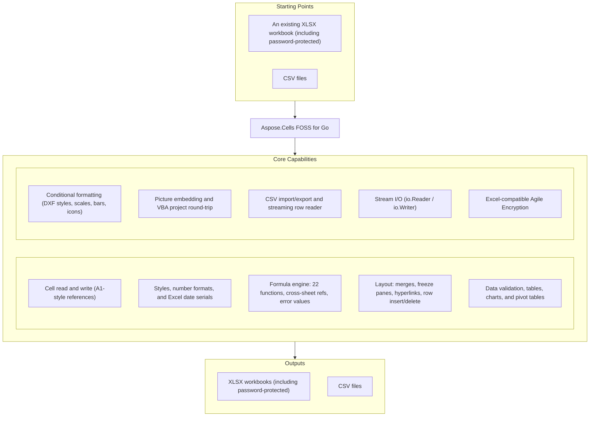

# Aspose.Cells FOSS for Go

[](https://go.dev) [](LICENSE) [](https://pkg.go.dev/github.com/aspose-cells-foss/Aspose.Cells-FOSS-for-Go/v26) [](https://github.com/aspose-cells-foss/Aspose.Cells-FOSS-for-Go/graphs/contributors)

[](https://products.aspose.org/cells/go/)

Aspose.Cells FOSS for Go is a pure-Go library for creating, reading, and writing Excel workbooks —
ECMA-376 Office Open XML `.xlsx` and `.xlsm` spreadsheets — with no third-party dependency. It
covers cell data and A1-style addressing, styles and number formats, worksheet layout (merged
cells, freeze panes, hyperlinks, row insert/delete), a built-in formula engine with cross-sheet
references and Excel error values, data validation, conditional formatting, structured tables,
charts, pivot tables, embedded pictures, VBA project round-tripping, CSV import and export,
low-memory row streaming for large files, stream I/O over any `io.Reader`/`io.Writer`, and
Excel-compatible password encryption. The current release is **26.11** — see
[CHANGELOG.md](CHANGELOG.md).

## Navigation

- [Aspose.Cells FOSS for Go](#asposecells-foss-for-go)
  - [Navigation](#navigation)
  - [At a Glance](#at-a-glance)
  - [Key Capabilities](#key-capabilities)
  - [Installation](#installation)
- [Requires **Go 1.24.5+** (see `go.mod`). Depends only on the Go standard library — no third-party modules.](#requires-go-1245-see-gomod-depends-only-on-the-go-standard-library--no-third-party-modules)
  - [Dependencies](#dependencies)
    - [Required Package Dependencies](#required-package-dependencies)
    - [Native and System Requirements](#native-and-system-requirements)
  - [Quick Start](#quick-start)
  - [Additional Examples](#additional-examples)
    - [Formulas and the Calculation Engine](#formulas-and-the-calculation-engine)
    - [Data Validation](#data-validation)
    - [Picture Embedding](#picture-embedding)
    - [Streaming Large Files](#streaming-large-files)
    - [Styling](#styling)
    - [Structured Tables](#structured-tables)
    - [CSV Import](#csv-import)
  - [Project Structure](#project-structure)
  - [API Reference](#api-reference)
    - [Cells Foss](#cells-foss)
  - [Documentation \& Resources](#documentation--resources)
  - [Scope and Limitations](#scope-and-limitations)
  - [Development and Testing](#development-and-testing)
  - [Detailed Documentation](#detailed-documentation)
  - [Constraints](#constraints)
  - [License](#license)

## At a Glance



## Key Capabilities

- Cell values are read and written through `Cells.Get`/`Cells.Set`, addressed by A1-style
  references (`"A1"`, `"B2"`) and covering `string`, `float64`, `int`, and `bool` values, with
  type-safe `Cell.AsString`/`AsFloat64`/`AsInt` accessors for reading.
- Font, fill, alignment, and borders combine into a `Style` applied to any cell via
  `Cell.SetStyle`, with automatic deduplication of identical styles during save. Styles carry
  number formats (built-in or custom codes), and `TimeToSerial`/`SerialToTime` convert between
  Go times and Excel date serials (1900 date system).
- Worksheets support merged cells, column widths, row heights, freeze panes, auto-filters, and
  cell hyperlinks, plus `InsertRow`/`DeleteRow` that shift cells and every range-bearing feature
  (merges, validations, tables, chart ranges, anchors — formula text is not rewritten).
- Formulas are stored with `Cell.SetFormula` and evaluated by the built-in `CalculateFormula`
  engine: 22 functions (`SUM`, `AVERAGE`, `MAX`, `MIN`, `COUNT`, `COUNTIF`, `VLOOKUP`, `IF`,
  `AND`, `OR`, `NOT`, `ROUND`, `ABS`, `POWER`, `SQRT`, `CONCAT`, `LEN`, `LEFT`, `RIGHT`, `MID`,
  `UPPER`, `LOWER`), arithmetic (`+ - * / ^ &`) and comparison operators, cross-sheet references
  (`Sheet2!A1`, `'My Sheet'!B2:C3`), and Excel error values (`#DIV/0!` and friends) that
  propagate through evaluation.
- Data validation rules (`DataValidation`) restrict a range to dropdown lists or whole/decimal
  ranges using any of the eight comparison operators, with custom error messages and error
  styles; conditional formatting (`ConditionalFormatting`) covers cellIs/text/expression rules
  with DXF styles plus color scales, data bars, icon sets, and top-N rules; structured `Table`
  ranges add header rows and auto-filters; `Chart` objects (bar, line, pie, scatter, area) carry
  axis titles and legends; `PivotTable` objects summarize a source range; `Picture` objects (PNG
  or JPEG) embed images; and VBA projects (`vbaProject.bin`) round-trip for `.xlsm` workbooks.
- `Workbook.SaveTo` writes to any `io.Writer`, and `LoadFrom`/`LoadFromWithPassword` read from
  any `io.Reader` — HTTP responses, zip entries, and network streams work without touching disk.
- `Workbook.ExportToCSV` and `Workbook.ImportFromCSV` move data to and from CSV with a
  caller-supplied delimiter; export converts typed cell values to their CSV string form via
  `CellToString` and writes a UTF-8 BOM with CRLF line endings for Excel, while import infers
  numeric and boolean types the way Excel does.
- The streaming reader (`StreamingReader.ProcessRows`) handles very large files with row-by-row
  processing, reading directly from the source path without first building the shared
  `Workbook`/`Worksheet` model, so peak memory stays proportional to the width of one row
  rather than the whole file.
- `Workbook.SetPassword` adds ECMA-376 Agile Encryption (SHA-512 key derivation, AES-256-CBC,
  HMAC-SHA512 integrity) in a standard OLE/CFB container that Microsoft Excel opens directly;
  `Workbook.CheckPassword` verifies a password in constant time.

## Installation

```bash
go get github.com/aspose-cells-foss/Aspose.Cells-FOSS-for-Go/v26/aspose/cells_foss
```

# Requires **Go 1.24.5+** (see `go.mod`). Depends only on the Go standard library — no third-party modules.

The module supports Go 1.24.5 or later and has zero third-party dependencies — encryption and
everything else builds on the Go standard library alone. Because the package name (`cells_foss`)
differs from the module path's final segment (`v26`), import it with an explicit alias:

```go
import cells_foss "github.com/aspose-cells-foss/Aspose.Cells-FOSS-for-Go/v26/aspose/cells_foss"
```

## Dependencies

### Required Package Dependencies

No required third-party package dependencies.

### Native and System Requirements

- Go 1.24 or later (`go.mod`'s own `go 1.24.5` directive).

## Quick Start

Create a workbook, write a couple of cells, and save it to disk:

```go
package main

import cells_foss "github.com/aspose-cells-foss/Aspose.Cells-FOSS-for-Go/v26/aspose/cells_foss"

func main() {
	// Create.
	wb := cells_foss.NewWorkbook()
	ws := wb.Worksheets[0]

	// Write.
	ws.Cells().Set("A1", "Hello, World!")
	ws.Cells().Set("B1", 42)

	// Save.
	wb.Save("hello.xlsx")
}
```

Run `go run main.go` to produce `hello.xlsx`.

Load an existing workbook, read and update a cell, then save the result:

```go
wb, _ := cells_foss.LoadWorkbook("input.xlsx")
ws := wb.Worksheets[0]

cell, _ := ws.Cells().Get("A1")
fmt.Println("Current value:", cell.AsString())

ws.Cells().Set("A1", "Updated value")
wb.Save("output.xlsx")
```

## Additional Examples

Runnable programs for every capability live under `examples/` in the repository. The formula
engine example is shown directly below; the rest are collapsed for space.

### Formulas and the Calculation Engine

```go
func main() {
	wb := cells_foss.NewWorkbook()
	ws := wb.Worksheets[0]

	// ---- Populate sales data ----
	data := []float64{1200, 850, 1400, 960, 1780}
	headers := []string{"Month", "Sales"}

	ws.Cells().Set("A1", headers[0])
	ws.Cells().Set("B1", headers[1])

	months := []string{"Jan", "Feb", "Mar", "Apr", "May"}
	for i, m := range months {
		row := i + 2
		ws.Cells().Set(fmt.Sprintf("A%d", row), m)
		ws.Cells().Set(fmt.Sprintf("B%d", row), data[i])
	}

	// ---- Add formula cells ----
	lastDataRow := len(data) + 1
	totalRef := fmt.Sprintf("B2:B%d", lastDataRow)

	// SUM formula.
	ws.Cells().Set("B7", nil)
	sumCell, _ := ws.Cells().Get("B7")
	sumCell.SetFormula(fmt.Sprintf("SUM(%s)", totalRef))

	// AVERAGE formula.
	ws.Cells().Set("B8", nil)
	avgCell, _ := ws.Cells().Get("B8")
	avgCell.SetFormula(fmt.Sprintf("AVERAGE(%s)", totalRef))

	// Labels.
	ws.Cells().Set("A7", "TOTAL")
	ws.Cells().Set("A8", "AVERAGE")

	// ---- Evaluate formulas with the engine ----
	for _, row := range []int{7, 8} {
		cell, _ := ws.Cells().Get(fmt.Sprintf("B%d", row))
		formula := cell.GetFormula()
		result, err := cells_foss.CalculateFormula(formula, ws)
		if err != nil {
			fmt.Printf("  %s = ERROR: %v\n", formula, err)
		} else {
			fmt.Printf("  %s = %v\n", formula, result)
		}
	}

	wb.Save("outputfiles/formula.xlsx")
}
```

<details>
<summary>View Additional Examples</summary>

### Data Validation

```go
func main() {
	wb := cells_foss.NewWorkbook()
	ws := wb.Worksheets[0]

	ws.Cells().Set("A1", "Fruit")
	ws.Cells().Set("A2", "Apple")
	ws.Cells().Set("A3", "Banana")

	// Create a list-type data validation.
	dv := &cells_foss.DataValidation{
		Type:             cells_foss.DataValidationTypeList,
		Formula1:         `"Apple,Banana,Cherry,Dragonfruit"`,
		AllowBlank:       true,
		ShowErrorMessage: true,
		ErrorTitle:       "Invalid Fruit",
		ErrorMessage:     "Please pick a fruit from the list.",
		ErrorStyle:       cells_foss.ErrorStyleStop,
	}

	if err := ws.AddDataValidation("A2:A10", dv); err != nil {
		fmt.Printf("Error: %v\n", err)
		return
	}

	wb.Save("outputfiles/data_validation.xlsx")
}
```

### Picture Embedding

```go
func main() {
	wb := cells_foss.NewWorkbook()
	ws := wb.Worksheets[0]

	ws.Cells().Set("A1", "Product Catalog")

	// generateSmallPNG returns a minimal PNG for the example; see
	// examples/picture/main.go for the full helper.
	pic := cells_foss.NewPicture(generateSmallPNG(), "png")
	pic.Width = 100
	pic.Height = 80
	pic.SetAnchor(5, 1) // row 5, column B

	if err := ws.AddPicture(pic); err != nil {
		fmt.Printf("Error adding picture: %v\n", err)
		return
	}

	wb.Save("outputfiles/picture.xlsx")
}
```

### Streaming Large Files

```go
func main() {
	sr := cells_foss.NewStreamingReader("outputfiles/streaming_data.xlsx")
	rowCount := 0
	var totalScore float64

	err := sr.ProcessRows("Sheet1", func(rowIdx int, cells map[string]string) error {
		rowCount++
		if score, ok := cells["C"+fmt.Sprint(rowIdx)]; ok {
			var s float64
			fmt.Sscanf(score, "%f", &s)
			totalScore += s
		}
		return nil
	})
	if err != nil {
		fmt.Fprintf(os.Stderr, "Error streaming: %v\n", err)
		os.Exit(1)
	}
	fmt.Printf("Streamed %d rows, total score %.0f\n", rowCount, totalScore)
}
```

### Styling

```go
func main() {
	wb := cells_foss.NewWorkbook()
	ws := wb.Worksheets[0]

	boldStyle := cells_foss.NewStyle()
	boldStyle.Font.Bold = true
	boldStyle.Font.Size = 12

	highlightStyle := cells_foss.NewStyle()
	highlightStyle.Font.Color = "FFFFFFFF"
	highlightStyle.Font.Bold = true
	highlightStyle.Fill = &cells_foss.Fill{
		Type:  cells_foss.FillTypeSolid,
		Color: "FF4472C4",
	}

	headers := []string{"Item", "Category", "Price", "In Stock"}
	for i, h := range headers {
		ref := string(rune('A'+i)) + "1"
		ws.Cells().Set(ref, h)
		cell, _ := ws.Cells().Get(ref)
		cell.SetStyle(boldStyle)
	}

	wb.Save("outputfiles/style.xlsx")
}
```

### Structured Tables

```go
func main() {
	wb := cells_foss.NewWorkbook()
	ws := wb.Worksheets[0]

	headers := []string{"Product", "Q1", "Q2", "Q3", "Q4", "Total"}
	for i, h := range headers {
		ref := string(rune('A'+i)) + "1"
		ws.Cells().Set(ref, h)
	}

	// ... populate data rows (see examples/table/main.go) ...

	tbl := ws.AddTable("A1:F6")
	tbl.HasHeaderRow = true
	tbl.StyleName = "TableStyleMedium6"

	wb.Save("outputfiles/table.xlsx")
}
```

### CSV Import

```go
func main() {
	csvPath := "outputfiles/employees.csv"

	wb := cells_foss.NewWorkbook()
	if err := wb.ImportFromCSV(csvPath, "Employees", ','); err != nil {
		fmt.Fprintf(os.Stderr, "Error importing CSV: %v\n", err)
		os.Exit(1)
	}

	ws := wb.Worksheets[1] // second sheet; index 0 is the default "Sheet1"
	fmt.Printf("Imported sheet: %q\n", ws.Name)

	wb.Save("outputfiles/csv_imported.xlsx")
}
```

</details>

## Project Structure

The library source lives under `aspose/cells_foss/`, with runnable examples, tests, a
verification tool, and a usage guide alongside it at the repository root:

```
├── aspose/cells_foss/        # Library source code
│   ├── workbook.go           #   Workbook entry point, save/load dispatch, stream I/O
│   ├── worksheet.go          #   Worksheet model, AddWorksheet (Excel name rules)
│   ├── cell.go / cells.go    #   Cell model and A1-keyed collection
│   ├── style.go              #   Font, fill, border, alignment, number format
│   ├── number_format.go      #   Number format codes and Excel date serials (1900 system)
│   ├── layout.go             #   Merges, column widths, row heights, freeze panes, auto-filter
│   ├── rowops.go             #   InsertRow/DeleteRow with full feature shifting
│   ├── hyperlink.go          #   Cell hyperlinks (external and internal)
│   ├── formula_engine.go     #   Formula evaluation (functions, arithmetic, cross-sheet refs)
│   ├── error_value.go        #   Excel error values with propagation through formulas
│   ├── datavalidation.go     #   Data validation (types and comparison operators)
│   ├── conditional_format.go #   Conditional formatting (DXF, scales, bars, icons, top-N)
│   ├── table.go              #   Structured tables
│   ├── chart.go              #   Charts: bar, line, pie, scatter, area; axes and legend
│   ├── pivot_table.go        #   Pivot tables
│   ├── picture.go            #   Picture embedding
│   ├── macro.go              #   VBA project storage (.xlsm round-trip)
│   ├── csv_handler.go        #   CSV import/export
│   ├── streaming_reader.go   #   Streaming row reader for large files
│   ├── crypto.go             #   Agile Encryption (SHA-512 + AES-256-CBC)
│   ├── olecfb.go             #   OLE/CFB container for encrypted workbooks
│   ├── errors.go             #   Custom error types
│   ├── xmlloader.go / xmlsaver.go                    # Workbook and sheet XML load/save
│   ├── xml_feature_loader.go / xml_feature_saver.go  # Styles, tables, drawings, CF, charts
│   ├── xml_sharedstrings_loader.go                   # sharedStrings.xml loading
│   └── test_helpers.go       #   Deprecated helpers used by tests/
├── tests/                    # Integration tests (public API)
├── examples/                 # 21 runnable example programs
│   ├── basic/                #   Create and save
│   ├── load_modify_save/     #   Load → modify → save
│   ├── typed_access/         #   Type-safe cell accessors
│   ├── style/                #   Style application
│   ├── number_format/        #   Number formats and date serials
│   ├── formula/              #   Formulas and calculation
│   ├── layout/               #   Merges, widths, freeze panes, auto-filter
│   ├── row_operations/       #   InsertRow/DeleteRow shifting
│   ├── stream_io/            #   SaveTo/LoadFrom over buffers
│   ├── streaming/            #   Streaming large data
│   ├── add_worksheet/        #   Adding named worksheets
│   ├── data_validation/      #   Data validation rules and operators
│   ├── conditional_format/   #   Conditional formatting rules
│   ├── table/                #   Structured tables
│   ├── chart/                #   Charts with axes and legend
│   ├── pivot_table/          #   Pivot tables
│   ├── picture/              #   Picture embedding
│   ├── macro/                #   VBA project round-trip (.xlsm)
│   ├── encryption/           #   Password-protected workbooks
│   ├── csv_export/           #   CSV export
│   ├── csv_import/           #   CSV import
│   └── go.mod                #   Separate module for examples (see Development and Testing)
├── docs/                     # Documentation
│   └── usage.md              #   Detailed usage guide
├── verify/                   # Verification tool
│   └── check_open_xlsx.go    #   .xlsx structure validator
├── doc.go                    # Package-level documentation
├── AGENTS.md                 # AI-assisted development guide
├── CHANGELOG.md              # Release history
├── go.mod
├── go.sum
└── README.md
```

## API Reference

The library's public surface is centered on `Workbook` and `Worksheet` — created with
`NewWorkbook`/`LoadWorkbook` (or `LoadFrom`/`SaveTo` for streams) and exposing a `*Cells`
collection through `Worksheet.Cells()` — with supporting types for styles and number formats,
layout and hyperlinks, formulas and error values, validation, conditional formatting, tables,
charts, pivot tables, pictures, VBA storage, and low-memory row access.

<details>
<summary>View the Supported Public API Surface</summary>

### Cells Foss

| Class                       | Description                                                                                                                     |
| --------------------------- | ------------------------------------------------------------------------------------------------------------------------------- |
| `Alignment`                 | Alignment controls how cell content is positioned within the cell bounds.                                                       |
| `Border`                    | Border defines which sides of a cell have a visible rule and the colour of those rules.                                         |
| `Cell`                      | Cell represents a single cell in a worksheet grid.                                                                              |
| `CellNotFoundError`         | Error returned by `Cells.Get` when the reference does not exist in the worksheet.                                               |
| `Cells`                     | Cells is a collection of Cell values indexed by A1-style string references (e.g. "A1", "B2", "Z100").                           |
| `Chart`                     | Chart represents a chart embedded in a worksheet (bar, line, pie, scatter, area).                                               |
| `ChartAnchor`               | ChartAnchor specifies the cell-based position and size of a chart on the worksheet.                                             |
| `ChartAxis`                 | ChartAxis configures one axis of a Cartesian chart (title, visibility).                                                         |
| `ChartLegend`               | ChartLegend configures a chart's legend (position, overlay).                                                                    |
| `ChartSeries`               | ChartSeries represents a single data series, referencing its category and value ranges.                                         |
| `ChartType`                 | Enum of the supported chart types.                                                                                              |
| `ColorScale`                | ColorScale is a gradient color-scale rule with thresholds and matching ARGB colours.                                            |
| `CondThreshold`             | CondThreshold is one color-scale stop, data-bar endpoint, or icon-set cutoff.                                                   |
| `ConditionalFormatting`     | ConditionalFormatting is a group of conditional-formatting rules applied to a range of cells (sqref).                           |
| `ConditionalFormattingRule` | ConditionalFormattingRule represents a single rule (cellIs, text, expression, colorScale, dataBar, iconSet, top10).             |
| `DataBar`                   | DataBar is an in-cell data-bar rule.                                                                                            |
| `DataValidation`            | DataValidation represents a single data-validation rule applied to a range of cells on a worksheet.                            |
| `ErrorValue`                | Excel error values (`#DIV/0!`, `#N/A`, …) usable as cell values and returned by formula evaluation.                             |
| `Fill`                      | Fill describes the background appearance of a cell.                                                                             |
| `Font`                      | Font describes the typographic properties applied to cell text.                                                                 |
| `FormulaError`              | Error returned when a formula cannot be parsed or evaluated.                                                                    |
| `Hyperlink`                 | Hyperlink is a cell hyperlink — external (`Target`) or internal (`Location`).                                                   |
| `IconSet`                   | IconSet is an icon-set rule with per-icon thresholds (17 built-in icon sets).                                                   |
| `InvalidRefError`           | Error for cell references that cannot be parsed.                                                                                |
| `LegendPosition`            | Enum of where a chart legend is drawn.                                                                                          |
| `Picture`                   | Picture represents an image embedded in a worksheet.                                                                            |
| `PivotDataField`            | PivotDataField represents a value field in a pivot table with its aggregation.                                                  |
| `PivotTable`                | PivotTable represents a pivot table on a worksheet (row, column, and data fields).                                              |
| `RowCallback`               | RowCallback is invoked by StreamingReader.ProcessRows once for every row in the worksheet.                                      |
| `SheetNotFoundError`        | Error for a formula reference to a sheet name that does not exist in the workbook.                                              |
| `StreamOptions`             | Optional row/column filters for StreamingReader; zero values mean no filtering.                                                 |
| `StreamingReader`           | StreamingReader reads an .xlsx workbook row by row without loading the entire sheet XML into memory.                            |
| `Style`                     | Style groups font, fill, alignment, border, and number-format settings into a named formatting record.                          |
| `Table`                     | Table represents a structured range of data (a "table" in Excel terminology) with optional header row and built-in auto-filter. |
| `VBAProject`                | Raw `vbaProject.bin` storage for macro-enabled (.xlsm) round-trips.                                                             |
| `Workbook`                  | Workbook is the top-level object representing an Excel workbook.                                                                |
| `Worksheet`                 | Worksheet represents a single sheet within a workbook.                                                                          |

</details>

## Documentation & Resources

- **[Getting started guide](https://docs.aspose.org/cells/go/)** — Go documentation for
  Aspose.Cells FOSS: loading, editing, styling, and saving spreadsheets.
- **[How-to guides & FAQ](https://kb.aspose.org/cells/go/)** — Go knowledge base for Aspose.Cells
  FOSS: how-to articles, FAQ, and troubleshooting guides.
- **[Full API reference](https://reference.aspose.org/cells/go/)** — the complete, browsable
  reference for the public API (the [API reference](#api-reference) section above covers the
  essentials).
- **[CHANGELOG.md](CHANGELOG.md)** — release history; the current release is **26.11**.
- **[AGENTS.md](AGENTS.md)** — the repository's own contribution guide for AI-assisted
  development, covering source-of-truth conventions and areas to avoid changing without review.
- Found a bug or have a feature request?
  [Open an issue](https://github.com/aspose-cells-foss/Aspose.Cells-FOSS-for-Go/issues) on GitHub.

## Scope and Limitations

- Cell references are A1-style strings only (`"A1"`, `"B2"`); tuple/array indices (e.g. `[0, 0]`)
  are not supported.
- `CalculateFormula` covers the 22 functions listed above, arithmetic/comparison operators, and
  same-workbook cross-sheet references; the full Excel function library, external-workbook
  references (`[Book.xlsx]Sheet!A1`), and a dependency-driven recalculation graph are not
  included. `InsertRow`/`DeleteRow` shift references but never rewrite formula text.
- Number formats use the 1900 date system only: `TimeToSerial`/`SerialToTime` reject serials
  below 61 (ambiguous because of Excel's 1900 leap-year bug) and dates beyond 9999-12-31. The
  1904 date system is not supported.
- Charts cover bar, line, pie, scatter, and area with axis titles, hidden axes, and legends;
  3D and combo charts, secondary axes, data labels, and gridline styling are not supported, and
  chart data is referenced by cell range, not embedded. Pivot tables cover row, column, and
  data fields; calculated fields, grouping, and custom aggregations are not supported.
- Conditional formatting does not cover the Excel 2010+ extensions (x14 gradient data bars,
  negative-value formats).
- Hidden rows/columns, outline grouping, print setup, and sheet protection are not modeled.
  Parts the library does not model (themes, docProps, comments, calcChain) are preserved
  byte-for-byte on round-trip instead.
- VBA support is storage-only: `vbaProject.bin` bytes round-trip, but VBA code cannot be
  created, edited, or executed.
- On save, unmodified content is reused verbatim from the original XML byte-for-byte, and only
  content touched since load is regenerated — round-trip fidelity depends on this split, not a
  full re-serialization of every part.
- Generated XML follows ECMA-376's own element ordering; this preserves round-trip compatibility
  but isn't independently configurable.

These limitations don't apply to
[Aspose.Cells for Go Enterprise Edition](https://products.aspose.com/cells/go-cpp/), which adds
the complete Excel formula function library, additional file-format coverage, and commercial
support.

## Development and Testing

Run the full test suite from the repository root:

```bash
go test ./...
```

<details>
<summary>More Test and Example Commands</summary>

Run only the integration tests (the public API surface):

```bash
go test ./tests/ -v
```

Run every bundled example program:

```bash
cd examples
for d in */; do go run ./$d; done
```

`examples/` is its own Go module, with a `replace` directive already pointing it back at the
repository root — the exact version named in its `require` line never needs to resolve to a real
published release, only to satisfy Go's own version-string syntax. If building or running anything
under `examples/` reports an invalid module version, replace that line's version with any
well-formed pseudo-version for major version 26 and re-run.

Example programs under `examples/` write their output files to `examples/outputfiles/` (created
on first run) — avoid committing generated `.xlsx`/`.csv` files or that directory's contents.

For a complete usage walkthrough beyond this README, see the repository's own
[docs/usage.md](docs/usage.md).

## Detailed Documentation

For the complete API reference and usage guide, see **[docs/usage.md](docs/usage.md)**.

## Constraints

- **A1-style references** (e.g. `"A1"`, `"B2"`) — tuple/array indices (e.g. `[0, 0]`) are not supported
- Modified content regenerates XML; unmodified content reuses original XML
- ECMA-376-compatible element ordering
- No third-party dependencies — Go standard library only
- Do not commit generated `.xlsx` files or contents of `outputfiles/`

## License

This project is licensed under the [MIT License](LICENSE). The MIT License permits use, copying,
modification, distribution, sublicensing, and commercial use, provided its copyright and
permission notice are retained. The software is provided without warranty.
